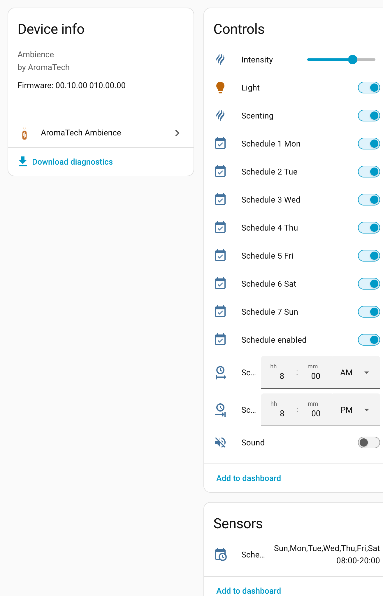
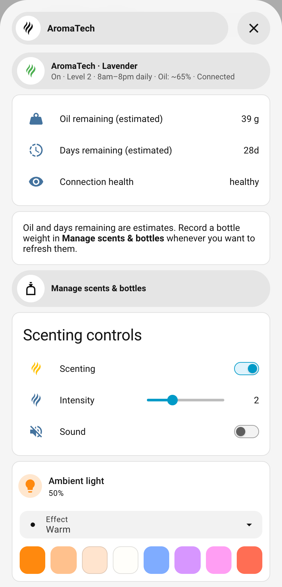

# Examples

Ideas for using the AromaTech Ambience integration, taken from a real setup.
Entity IDs assume the device is named **Ambience** (the default). If you
renamed it, adjust the IDs to match.

## What the integration gives you

The device page after setup: scenting, intensity, sound, the light, and the
full schedule, plus a diagnostics download for bug reports.

## A dashboard card

[`dashboard-card.yaml`](dashboard-card.yaml) builds a dashboard card from core
Home Assistant cards only: a status line, scenting controls, the ambient light
with its effects and favourite colours, and the schedule. The file explains how
to wrap it in a Bubble Card pop-up, but it also works without one.

## Bubble dashboard and bottle management

[`dashboard-bubble.yaml`](dashboard-bubble.yaml) adds a Bubble summary button,
an AromaTech popup with the existing controls and estimate rows, and a separate
scents/bottles management popup. It preserves Bubble's normal pill shape and
height. Main and popup summaries show scent, power, level, schedule, oil estimate
and connection health. The popup keeps oil grams, days remaining, connection and
contextual guidance. The core-card example above is still available.

Current 0.6.1 dashboard example, shown with illustrative scent and oil values.

The current example requires **integration 0.6.1 or later**, plus Card-mod for
grey saved-schedule styling and
[Bubble Card](https://github.com/Clooos/Bubble-Card) installed as a dashboard
resource. The example was checked with Bubble Card 3.4.0. The optional management
form uses the included local module; it does not replace the Bubble summaries.
These example files are included starting with the **0.6.0b2** tag and its
separate dashboard-examples ZIP. The archived b2 example still works with b1.
The b4 example adds the Always on switch: On saves and suspends timed schedules;
Off restores them. While active, the saved days/times are visible as grey read-only
rows. Enable Experimental schedule writes before first use. Scenting remains the
separate master power switch. The recovery action appears only after an unfinished
mode transition; it requests restoration without changing master power.

### Install the example

1. Copy [`www/aromatech-inventory-card.js`](www/aromatech-inventory-card.js) to
   `/config/www/aromatech-inventory-card.js` on Home Assistant. Create `www` if
   needed. This example resource is not installed automatically by HACS when
   updating the integration.
2. Add a dashboard resource with URL `/local/aromatech-inventory-card.js?v=1`
   and type **JavaScript module**. Refresh the browser after registering it.
   Increment the query version when replacing this file to refresh cached code.
3. In the YAML, replace **every** `replace_me` entity ID, including IDs inside
   `styles` JavaScript. Copy real IDs from the device page or Developer Tools →
   States; the placeholders are not guaranteed defaults.
4. Replace `REPLACE_WITH_CONFIG_ENTRY_ID` with this diffuser integration's entry
   ID. In Developer Tools → Actions, select `aromatech_ambience.list_inventory`,
   choose the integration entry, then inspect YAML for `config_entry_id`.
   Use the entry ID, not the device ID or an entity ID.
5. Add the YAML as one manual dashboard card. Its vertical stack includes the
   summary and both popups. The hashes `#aromatech` and `#aromatech-manage` must
   be unique on that dashboard. For another diffuser, duplicate the stack with
   distinct hashes and update every navigation path, entry ID and entity mapping.
   Also set the manager's `management_path` to its renamed popup hash.

Mapping checklist (some installations include an area prefix):

| Placeholder suffix | Entity to select |
|---|---|
| `scenting` | Scenting switch |
| `intensity` | Intensity number |
| `installed_scent` | Installed scent sensor |
| `bottle_oil_remaining` | Bottle oil remaining **percentage** sensor |
| `estimated_oil_remaining` | Estimated oil remaining **grams** sensor |
| `bottle_refill_status` | Bottle refill status sensor |
| `estimated_days_remaining` | Estimated days remaining sensor |
| `bluetooth_health` | Bluetooth health sensor (continuous-counter update) |
| `always_on` | Experimental Always on switch |
| `sound`, `light`, `schedule_enabled`, `schedule_from`, `schedule_to`, `schedule` | Existing corresponding device entities |

### Using the popups

Tap the summary, then **Manage scents & bottles**. Add/edit scents and bottles,
weigh/correct, refill a stored bottle, archive/restore, delete or acknowledge an
alert. All actions use the integration's existing inventory; there is no second
database. Opening the popup never operates the diffuser. Installation/storage
guides you through explicit Stop → physical change → save selection → Resume.
Deletion requires confirmation for the selected record and removes its history.
Scents referenced by bottle history and active bottles cannot be deleted.

Green means OK; yellow means refill soon, needs weighing or needs calibration;
red means low/estimated depleted; grey means no bottle or unavailable forecast/data.
Text labels accompany colours. The values are estimates, not an oil-level sensor.
The summary distinguishes connection health from oil-status colour. Technical
pump/cycle counters and Bluetooth timestamp/age stay in optional diagnostics;
none is required for the simple popup. Missing health hides its row and shows
Connection unknown. The example does not install the integration or change settings.

### Quick setup without a scale

Add a scent by name; it uses an approximate **4 mg per 5 seconds** rate. Add a
bottle and choose **30 / 60 / 120**, with **60** selected initially, or enter a
custom oil amount. Presets are approximate starting balances, not measured mass
or density. Empty-bottle weight is optional until you choose actual weighing.
Custom rate and measured-weight paths remain available. Existing learned/custom
rates are preserved. See [calibration and units](../docs/BOTTLES.md#rates-and-weighing).

Schedule controls here edit **only the first slot**, preserving other slots.
The integration can read up to five slots; extended writes remain experimental
and require the integration option. This example does not implement a multi-slot
editor or enable experimental writes. Firmware checking is not included.

For a setup without the management module, remove the management popup and its
navigation buttons and manage inventory through the integration's **Configure**
menu instead. Removing the dashboard resource does not delete bottle records.

### Validation

Run `node --test tests/aromatech-inventory-card.test.mjs` from the repository root
with Node.js 22 or newer. The source was exercised in desktop and mobile HA
previews with mutations intercepted; those tests are not physical-device tests.
Example placeholders must be mapped before testing your own dashboard.

## Automation ideas

[`automations.yaml`](automations.yaml) contains three ready-to-paste
automations:

1. **Day and night light level.** The lamp at 50% during the day and a 5%
   glow at night, keeping the selected effect.
2. **Pause scenting while away.** Turns scenting off after everyone has been
   out for 30 minutes, and restores exactly what it was on return.
3. **Unreachable alert.** A notification if the diffuser has been out of
   Bluetooth reach for an hour.

## Tips

- **Scenting on is not continuous spraying.** The device sprays in cycles set
  by the intensity level, and only inside its schedule window.
- **Intensity is part of the schedule.** Changing it rewrites the schedule on
  the device, and the integration confirms the new value before reporting
  success.
- **Keep the Bluetooth connection free.** Each poll connects briefly and then
  disconnects, so the diffuser does not permanently hold one of a proxy's few
  connection slots. Longer heartbeat intervals (Options) mean fewer
  connections.
